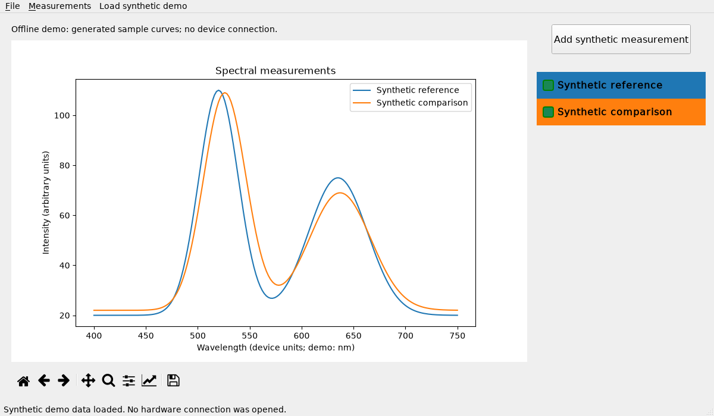

# Spectrometer Desktop

A Python desktop application for plotting spectra, managing measurement files
and comparing aligned measurements. The offline demo starts with two clearly
labelled synthetic curves and requires no connected instrument.



This is a curated continuation of a recovered personal application, suitable
as a scientific-software and serial-integration portfolio example. The scope
and recovered-source history are described in [PROVENANCE.md](PROVENANCE.md).

## Run the offline demo

Use Python **3.12**. These commands create a project-local environment and do
not install packages globally.

Windows PowerShell:

```powershell
py -3.12 -m venv .venv
.\.venv\Scripts\python.exe -m pip install -r requirements.txt
.\.venv\Scripts\python.exe Spektrometar.py --demo
```

Linux/macOS equivalent:

```bash
python3.12 -m venv .venv
.venv/bin/python -m pip install -r requirements.txt
.venv/bin/python Spektrometar.py --demo
```

The dependency versions are pinned to the environment used for verification.
The GUI was verified offscreen on Windows; Linux/macOS desktop behavior has
not been checked. Running without arguments also selects the offline demo.

## What you can demonstrate

- Overlay spectra and use Matplotlib's pan/zoom toolbar.
- Toggle individual curves and rename/delete them with a right click.
- Use **File → Save measurements** to export selected curves, then reopen
  the text file through **File → Open measurements**.
- Use **File → Export plot** for PNG, JPG or PDF output.
- Use **Measurements → Compare measurements** to show Pearson correlation
  between two curves on the same wavelength grid.
- Load another synthetic pair at any time with **Load synthetic demo**.

Duplicate imported names receive numbered suffixes. A malformed measurement
file is rejected before any of its records are added. Constant spectra and
different wavelength grids produce a clear comparison error rather than an
undefined result. Closing during acquisition requests cancellation and waits
for the worker to release the device.

## Optional hardware acquisition

Hardware acquisition is enabled explicitly:

```powershell
.\.venv\Scripts\python.exe Spektrometar.py --hardware --port COM3 --timeout 10
```

On Linux the port might be `/dev/ttyUSB0`; select the actual device port. If
`--port` is omitted, the original Arduino-description heuristic is used, and
ambiguous matches are rejected. Required operating-system drivers must be
obtained from the device/vendor; none are bundled.

The recovered protocol uses **115200 baud**, sends the byte `m` to trigger a
measurement, and reads ASCII lines in this form:

```text
x=d,400.0,y=v,123.4
x=d,402.0,y=v,127.8
x=e
```

The third field is treated as an opaque device label, matching the original
driver. Other device chatter is ignored. Reads accept fragmented lines, cap
each row at 256 bytes and each measurement at 4096 points, and require the
`x=e` terminator before accepting the data. The acquisition deadline is
configurable between 0 and 60 seconds; individual reads wait at most 0.2
seconds, and the command write has a one-second timeout. Serial IO runs in
a `QThread`, so it does not block the GUI event loop.

**Physical hardware has not been tested in this curated version.** No firmware,
device specification or calibration data was recovered. The synthetic demo is
not an instrument reading. Intensity is shown in arbitrary units; correlation
compares curve shape and does not identify materials or establish measurement
accuracy. Automatic resampling, calibration and continuous acquisition are
outside this example's scope.

## Measurement file format

Each block begins with a one-line name, followed by `wavelength, intensity`
numeric pairs. A blank line separates blocks. At least two finite pairs are
required. Exports use UTF-8; imports also support legacy Bulgarian Windows
CP1251 files.

```text
Example A
400, 10
402, 12

Example B
400, 9
402, 13
```

Measurements remain in memory until explicitly exported. The application does
not write data beside its source and can be launched from another working
directory. No personal measurement files are included.

## Tests and verification

```powershell
.\.venv\Scripts\python.exe -m unittest discover -s tests -v
```

**27 tests passed** on Windows with Python 3.12.4, NumPy 2.5.4,
Matplotlib 3.11.2, PyQt5 5.15.11 and pyserial 3.5. Tests use the standard
library's `unittest`, synthetic measurements and fake serial connections.
They never contact hardware or a network. GUI tests select Qt's offscreen
platform automatically.

Coverage includes text/encoding round trips, invalid imports, correlation
edge cases, fragmented serial rows, deadlines, device disconnects, resource
cleanup, GUI responsiveness, cancellation, duplicate names and plot export.
The screenshot above was captured from the running offline demo and visually
inspected. A physical-device test and desktop testing on other operating
systems remain outstanding.

## Code map

| File | Responsibility |
|---|---|
| `Spektrometar.py` | PyQt5 interface, plotting and acquisition worker lifecycle. |
| `measurements.py` | Named text format, validation, comparison math and synthetic samples. |
| `spectrometer_driver.py` | Device discovery, protocol parsing and bounded serial acquisition. |
| `tests/` | Offline unit and GUI regression tests. |

The original application workflow and much of the GUI structure are retained;
this is a focused maintenance and demonstration pass. External dependencies
retain their own licenses. See [PROVENANCE.md](PROVENANCE.md) for attribution
and publication scope; no new project-code license was assigned.
